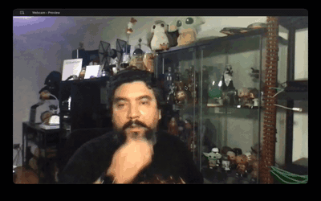

# VanishCam — webcam disappearance effects



*Goku Instant Transmission mode — fingers to forehead, 1 second hold, and you're gone.*

Video is processed on your computer. It is neither recorded nor sent to a server. The preview window and virtual camera show only the video and effects, without overlaid menus, instructions, or text.

For step-by-step instructions in English and Italian, see the [user guide](USER_GUIDE_EN_IT.md).

**macOS users** (Intel and Apple Silicon): see [README_MAC.md](README_MAC.md) for the native setup, launcher scripts, and `.app` build.

**Linux users** (x86_64 and aarch64): see [README_LINUX.md](README_LINUX.md) for the system packages, the `v4l2loopback` virtual-camera setup and the PyInstaller build.

## What this fork adds over [Nicovic17/vanish_webcam](https://github.com/Nicovic17/vanish_webcam)

- **Goku Instant Transmission mode.** Third vanish mode triggered by holding
  index + middle fingers against the forehead for one second (or pressing
  `V`). Replicates the DBZ *Shunkan Idō* look: ki aura build-up, vertical
  *shūchūsen* speed lines over the silhouette, warp distortion, white flash,
  and the person fades into the captured background. Hold the gesture again
  (or press `V`) from the vanished state to play the full reverse animation
  and reappear. Teleport sound included (`assets/teleport.mp3`); the forward
  and reversed playback are peak-aligned so the loudest moment lands on the
  actual vanish and reappear frames. Face landmarker + hand landmarker from
  MediaPipe handle the detection. Keyboard: `V` triggers, `R` resets, `SPACE`
  recaptures the background.
- **Native macOS support (Intel + Apple Silicon).** New launcher scripts
  `START_LOCAL.sh` / `START_VIRTUAL.sh` / `START_OBS.sh`, a PyInstaller spec
  (`VanishCam_mac.spec`) and a `BUILD_MAC.sh` that produces a `.app` bundle
  with camera permission plist. The upstream Windows `.bat` scripts were
  renamed from `AVVIA_*` to `START_*` to match. [`README_MAC.md`](README_MAC.md)
  has the full setup guide.
- **English translation.** All UI strings, print output, argparse help texts,
  comments and docstrings translated from Italian to English across every
  Python file. The window title is now `Webcam - Preview`.
- **Fewer dependency and run-time surprises.** The `mediapipe==1.0.1` pin (not
  on PyPI) is loosened to `mediapipe>=0.10.14,<1`. Native-side log chatter
  from mediapipe, TFLite, absl/glog and the pygame support banner is
  suppressed so the terminal stays readable; `GLOG_minloglevel=0` reopens it
  when debugging. The protobuf `SymbolDatabase.GetPrototype` /
  `MessageFactory` deprecation warnings are filtered.
- **Documentation trim.** The upstream README listed four modes
  (Normal / Naruto / Particles / Goku) but only Normal and Naruto were
  implemented in the source. Particles and Goku references were removed from
  the README; Goku has since been implemented in this fork and is documented
  below.

## ☕ Buy me a coffee

If you like this project and want to support it, you can buy me a coffee through [PayPal](https://paypal.me/nicovic17) or [Revolut](https://revolut.me/nicoauriemma).

## Download for Windows

[Download VanishCam.exe]( https://nicoaauriemma.vercel.app/shop ) and double-click it to run the app. You do not need to install Python.

## Getting started

1. Double-click `START_LOCAL.bat`.
2. In the start menu, choose **Normal Vanish**, **Naruto Vanish** or **Goku Vanish** with the mouse or the `1`, `2`, `3` keys.
3. Step out of the camera frame for 4 seconds while the background is captured. The terminal tells you when you can step back in.

**Normal Vanish:** Raise your index and middle fingers in a V sign. The dissolve starts as soon as the gesture is recognized and lasts about 3.6 seconds.

**Naruto Vanish:** Bring your palms together in front of the webcam, with your fingers side by side rather than interlaced. Keep both hands visible. As soon as the gesture is recognized, you vanish in a cloud of smoke and a wooden log appears, falls, and remains visible until you press `R`. No microphone is needed. Naruto mode uses `hand_landmarker.task` to track both hands. `assets/vanish.MP3` plays through your computer speakers when the disappearance starts, including when triggered with `V`. You can trigger it again after pressing `R`.

**Goku Vanish:** Hold your index and middle fingers straight and together against your forehead for 1 second. A cyan ki aura builds up, vertical speed lines run across your silhouette, a white flash hits, and you fade into the captured background with `assets/teleport.mp3` playing. To reappear, hold the same gesture again (or press `V`); the full reverse animation plays with the reversed audio. `R` snaps back to idle without animation. The gesture detector uses `face_landmarker.task` for the forehead point and `hand_landmarker.task` for the finger tips; both are loaded only in this mode.

To start a mode without the menu:

```powershell
START_LOCAL.bat --mode naruto
START_LOCAL.bat --mode normal
START_LOCAL.bat --mode goku
```

## Virtual camera and OBS

If [OBS Studio](https://obsproject.com/) is installed, the app automatically tries to open **OBS Virtual Camera**. The terminal shows the device name. Use `START_VIRTUAL.bat` to require a virtual camera. Select **OBS Virtual Camera** in the app that will receive the video. OBS's virtual camera must be stopped while this app is producing its output.

To use the effect in an OBS scene, run `START_OBS.bat`, add a **Window Capture** source, select **Webcam - Preview**, and then start the virtual camera from OBS. Alternatively, use [Unity Capture](https://github.com/schellingb/UnityCapture) as a separate virtual video source:

```powershell
START_VIRTUAL.bat --virtual-backend unitycapture
```

OBS has only one virtual camera. Do not use it as both an OBS input and output at the same time. See the [pyvirtualcam documentation](https://github.com/letmaik/pyvirtualcam#supported-virtual-cameras).

## Controls

- `SPACE`: capture a new background.
- `R`: make the person reappear.
- `V`: manually start the selected mode's effect.
- `F`: toggle fullscreen.
- `Q` or `ESC`: quit and release the cameras.

You can change the camera, resolution, and maximum virtual-output FPS:

```powershell
START_LOCAL.bat --camera 1 --width 1280 --height 720 --fps 30
```

To troubleshoot gesture recognition without adding text to the video, pass `--gesture-debug`. Diagnostic information appears only in the terminal.

## Visual assets

The [wooden log](assets/substitution_log.png) is an original illustration generated with ImageGen using the supplied image as a visual reference. Smoke is drawn in real time by `naruto_effect.py` so it follows the person's position and scales with the video. We also considered a [CC0 smoke sprite sheet](https://opengameart.org/content/smoke-sprite-sheet), but the procedural animation adapts better to dynamic positioning without an additional asset. No anime frames or assets are included in the project.
